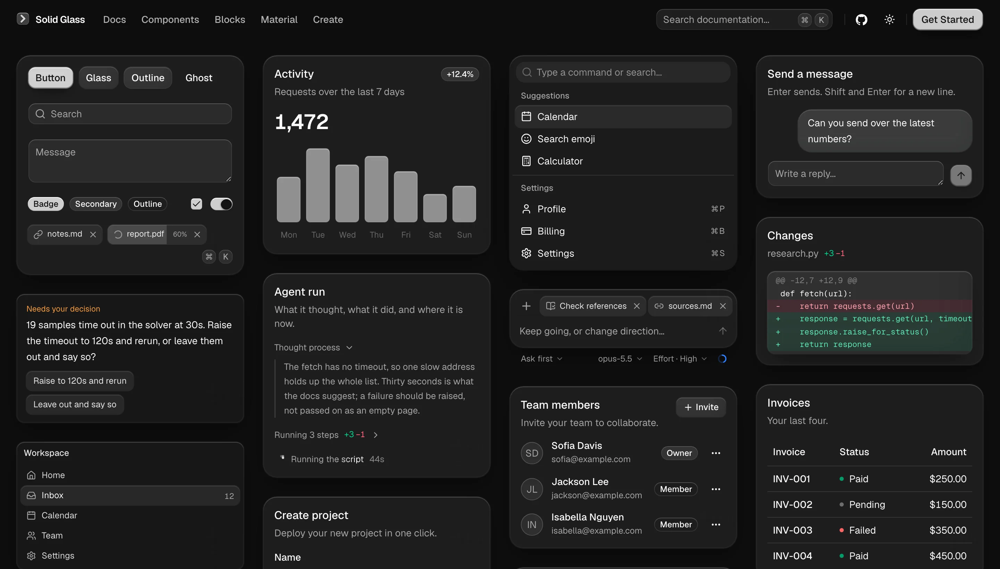
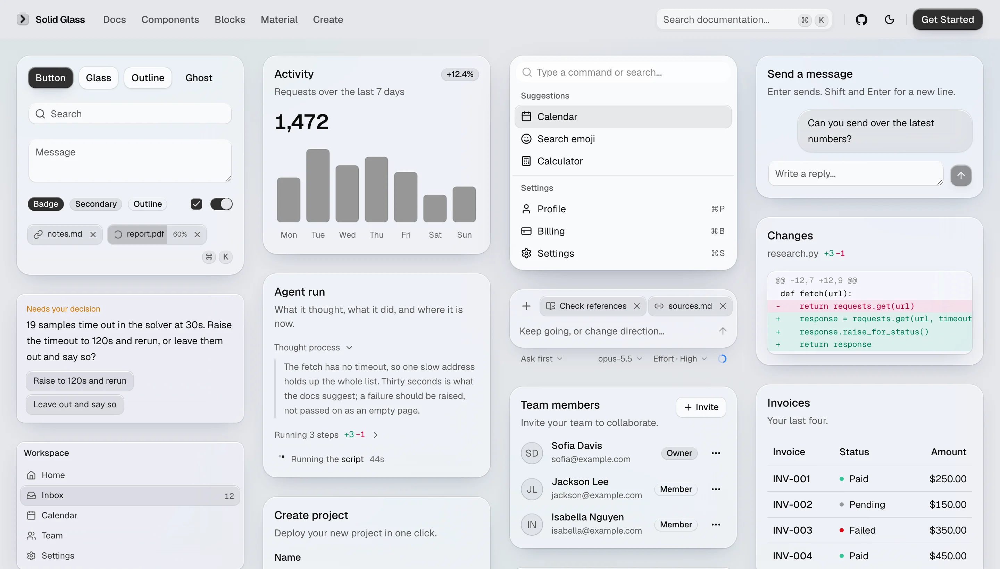

<div align="center">


</div>

# Solid Glass

<div align="center">

[The style](#the-style) · [Install](#install) · [What is here](#what-is-here) · [Contributing](#contributing)

[](https://github.com/deeplethe/solid-glass/stargazers)
[](LICENSE)
[](https://deeplethe.github.io/solid-glass/docs/components/status-glyph)
[](https://ui.shadcn.com)

[](https://deeplethe.github.io/solid-glass)
[](https://deeplethe.github.io/solid-glass/r/registry.json)
[](https://tailwindcss.com)
[](https://react.dev)
[](https://github.com/deeplethe)

</div>

A refined glass-inspired aesthetic that feels solid from afar and reveals its subtle materiality up
close. Delicate highlights, fine borders, and soft shadows create depth, while a restrained finish
emphasizes clarity, stability, and a sense of solidity over transparency, refraction, and fluidity.

[](https://deeplethe.github.io/solid-glass/blocks)

That is one of the [blocks](https://deeplethe.github.io/solid-glass/blocks): whole screens made of the
components, to look at, read and copy in. Below, the components themselves.





It stands between flat design and liquid glass. Flat is an opaque block with no finish to speak of;
liquid glass is nearly clear, and on a page with a lot of text the reader is always fighting the
background for the words. Solid Glass lets only an outline through: enough to know it is glass, not
enough to get in the way of reading.


## The style

| | |
|---|---|
| **Tactility** | Interfaces that feel tangible. Every interaction carries a subtle sense of touch and response. |
| **Precision** | Clean geometry, refined details, and restrained lighting create a precise, technical aesthetic. |
| **Physicality** | Depth comes from thickness, shadow, and spatial hierarchy, giving every element a sense of physical presence. |
| **Materiality** | Subtle edge highlights, fine borders, and soft shadows define the character of each surface. |

### Why it is built this way

AI applications are built around information that is constantly changing — responses streaming in,
agents performing tasks, and decisions waiting for human input.

Solid Glass keeps the interface calm and readable. Neutral surfaces reduce visual distractions,
depth establishes hierarchy, and color and motion are reserved for meaningful feedback.

The entire system is built with lightweight CSS and works with existing shadcn/ui components in both
light and dark modes.

The [Material](https://deeplethe.github.io/solid-glass/docs/material) page shows how a pane is made,
and the [Create](https://deeplethe.github.io/solid-glass/create) page lets you turn the dials.

## Install

Solid Glass is one stylesheet. It finds each part of a shadcn/ui component by the `data-slot` and
the classes it already carries, so the components you have need no changes.

Start from a shadcn/ui project (React 19, Tailwind CSS 4, the Base UI components):

```bash
npx shadcn@latest init
```

Add the stylesheet, straight from this repository:

```bash
npx shadcn@latest add deeplethe/solid-glass/solid-glass
```

Import it after Tailwind and shadcn's stylesheet, and delete the `:root` and `.dark` colour
variables that `shadcn init` wrote (Solid Glass defines the same names):

```css
@import "tailwindcss";
@import "tw-animate-css";
@import "shadcn/tailwind.css";
@import "./solid-glass.css";
```

Dark is the material as designed; light is there too. The
[installation page](https://deeplethe.github.io/solid-glass/docs/installation) has the rest.

Solid Glass's own components install the same way:

```bash
npx shadcn@latest add deeplethe/solid-glass/status-glyph
```

| Component | What it is |
|---|---|
| `status-glyph` | Three points of light that say a turn is going, and what it is doing. |
| `panel`, `tag`, `dot-loader` | The thinnest pane, a small label, and a row of dots that waits. |
| `turn-status`, `composer`, `tool-steps`, `diff-view`, `ask-card`, `context-ring`, `task-notice`, `reasoning` | For interfaces where an agent works: its status line, the box you write to it in, the steps it took, a diff, a question it asks, how full its context is, a notice from a task, and its thinking. |

## What is here

| Path | What it is |
|---|---|
| `src/solid-glass.css` | The theme. The whole material in one file: colours, the three thicknesses of glass, the one state, motion. It defines shadcn/ui's own variable names. |
| `registry.json` | The registry: what `shadcn add` installs from. Written by `scripts/build-registry.mjs`, which also builds `public/r/` for the site. |
| `src/components/ui/` | The components the site shows. shadcn/ui's (Base UI, `base-nova`), installed with its command line, and Solid Glass's own. A few of shadcn/ui's (`button`, `input`, `tabs`, `dialog`, `dropdown-menu`, `sheet`, `sidebar` and some form controls) differ from stock in small ways; the stylesheet does not depend on those differences. |
| `src/create/`, `src/pages/create.tsx` | The Create page: the material with its dials out (thickness, tint, chart colour, type, radius, rim, blur), a preview that takes each choice as it is made, and the few lines of CSS that come of it. `options.ts` says what each choice does to the stylesheet's variables; the preview cards are shadcn/ui's. |
| `src/blocks/`, `src/pages/blocks.tsx` | Blocks: whole screens made of the components, shown on the Blocks page in a frame of their own (`/view/<name>`). The single files at the top of the folder are Solid Glass's own (`agent-workspace`) and are in its registry; the folders are shadcn/ui's blocks in the material, installed from shadcn/ui. |
| `src/examples/` | One small file per example, as on ui.shadcn.com: shadcn/ui's own examples, and Solid Glass's for its own components. |
| `content/` | The documentation. `components/` is shadcn/ui's page for each component; `solid/` and `docs/` are Solid Glass's. |
| `src/site/`, `src/pages/`, `src/home/` | The site: header, sidebar, component preview, and the wall of cards on the home page. |
| `.github/` | The checks every pull request must pass (`checks.yml`), the workflow that publishes `main` (`pages.yml`), and the templates for issues and pull requests. |
| `scripts/build-docs.mjs` | Turns `content/` into `src/docs/generated.json`, which the site renders. |

## Run

```bash
npm install
npm run dev         # http://localhost:5191
npm run build       # into dist/
npm run typecheck
```

`/dev/banner` (development only) is the banner above, drawn with the theme: `docs/banner-5.webp` is a
screenshot of it in an 820 by 200 window at twice the size, saved as WebP like the other pictures
here (a quarter of the size of the same picture as PNG). When the picture changes, save it under
the next number and point the README at that: GitHub serves a README's pictures from one address
per file, whatever is added to the link, and a browser keeps what it fetched from it.

`/dev/examples` (development only) mounts every example at once and lists any that fail. It takes
`?q=button,card` to show some of them, `?theme=light`, `?hover=<selector>` to show what matches as
if the pointer were on it, and `?click=<selector>` to press something and look at what it opens.

`SOLID_GLASS_ORIGIN` is the address the site is served from (Solid Glass's own components name one
another by it) and `SOLID_GLASS_BASE` the path it lives under there; the defaults are this
repository's GitHub Pages.

## Add a component of Solid Glass's own

1. `src/components/ui/<name>.tsx`, written like a shadcn/ui component: function components, a
   `data-slot` on every part, `cn()` from `@/lib/utils`.
2. `src/examples/<name>-demo.tsx`, and one file per further example.
3. `content/solid/<name>.mdx`: front matter (`title`, `description`), then
   `<ComponentPreview name="<name>-demo" />`, Installation, Usage, and a heading per example.

Keep to the four rules (the Material page shows them): the finish is at the edge; heavy, not airy;
depth is thickness; one state.

## Contributing

Changes land on `dev` by pull request and reach `main`, and with it the published site and
registry, when a maintainer merges `dev` into it. [CONTRIBUTING.md](CONTRIBUTING.md) has the rest
([中文](CONTRIBUTING.zh-CN.md)): what to open an issue for first, what to run before pushing, and
what review sends back. How we treat each other is in the [Code of Conduct](CODE_OF_CONDUCT.md);
security reports go to the address in [SECURITY.md](SECURITY.md).

## Licence

[MIT](LICENSE). The components, examples and component documentation that come from shadcn/ui are
its authors', also under the MIT License: see [NOTICE.md](NOTICE.md).
